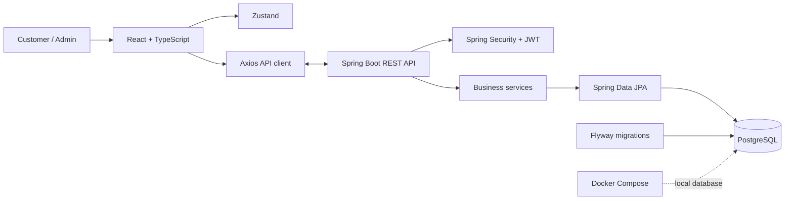

<div align="center">

# MRS. DEORE'S Platform

**A full-stack marketplace built for customers and the team behind the store.**

[](https://www.oracle.com/java/)
[](https://spring.io/projects/spring-boot)
[](https://react.dev/)
[](https://www.typescriptlang.org/)
[](https://www.postgresql.org/)
[](https://www.docker.com/)

[Explore screenshots](#-product-screenshots) · [Get started](#-quick-start) · [Architecture](#-architecture)

</div>

---

## About

MRS. DEORE'S Platform is a full-stack marketplace web application. Customers can browse products, manage a cart and wishlist, place and review orders, and submit custom order requests. Store administrators have dedicated tools for managing products, categories, orders, notifications, and settings.

The repository is organized as a monorepo: a React and TypeScript frontend, a Java Spring Boot REST API, and a PostgreSQL database for persistence.

## ✨ Highlights

- Product catalog, product details, and search
- Customer accounts, authentication, and profile management
- Cart, wishlist, addresses, checkout, and order history
- Custom order requests and customer notifications
- Admin dashboard for catalog, category, order, and team workflows
- REST API secured with Spring Security and JWT
- PostgreSQL persistence with Flyway database migrations
- Integrations for Razorpay payments, email, and Cloudinary media uploads
- Docker Compose configuration for local PostgreSQL development

## 📸 Product Screenshots

The screenshots are listed in the same order as supplied. Each preview links to its Cloudinary collection so you can open the shared image directly. **Screenshots 06 and 07 use the same supplied link.**

> **Image link note:** These are Cloudinary collection-share URLs rather than direct image-file URLs. If a preview is not rendered by GitHub, use its **Open screenshot** link to view the collection.

<details open>
<summary><strong>01 — Marketplace screen</strong></summary>

<a href="https://collection.cloudinary.com/dyfpdcteo/ca59c4105a156f6bcd05b831ddf0b7b8"></a>

[Open screenshot 01](https://collection.cloudinary.com/dyfpdcteo/ca59c4105a156f6bcd05b831ddf0b7b8)
</details>

<details>
<summary><strong>02 — Marketplace screen</strong></summary>

<a href="https://collection.cloudinary.com/dyfpdcteo/bd37ff89ba3b5432d27a74cbbea198fb"></a>

[Open screenshot 02](https://collection.cloudinary.com/dyfpdcteo/bd37ff89ba3b5432d27a74cbbea198fb)
</details>

<details>
<summary><strong>03 — Marketplace screen</strong></summary>

<a href="https://collection.cloudinary.com/dyfpdcteo/1214628998f6c337c7786205b0cbed65"></a>

[Open screenshot 03](https://collection.cloudinary.com/dyfpdcteo/1214628998f6c337c7786205b0cbed65)
</details>

<details>
<summary><strong>04 — Marketplace screen</strong></summary>

<a href="https://collection.cloudinary.com/dyfpdcteo/5f8eea5dfc3cd7c4ecc8e24e4eddd472"></a>

[Open screenshot 04](https://collection.cloudinary.com/dyfpdcteo/5f8eea5dfc3cd7c4ecc8e24e4eddd472)
</details>

<details>
<summary><strong>05 — Marketplace screen</strong></summary>

<a href="https://collection.cloudinary.com/dyfpdcteo/ca98cd6b66dacd8943b044a3c2b7b914"></a>

[Open screenshot 05](https://collection.cloudinary.com/dyfpdcteo/ca98cd6b66dacd8943b044a3c2b7b914)
</details>

<details>
<summary><strong>06 — Marketplace screen</strong></summary>

<a href="https://collection.cloudinary.com/dyfpdcteo/77dee354adde4551b5cba30e2b5f3d8e"></a>

[Open screenshot 06](https://collection.cloudinary.com/dyfpdcteo/77dee354adde4551b5cba30e2b5f3d8e)
</details>

<details>
<summary><strong>07 — Marketplace screen (same link as 06)</strong></summary>

<a href="https://collection.cloudinary.com/dyfpdcteo/77dee354adde4551b5cba30e2b5f3d8e"></a>

[Open screenshot 07](https://collection.cloudinary.com/dyfpdcteo/77dee354adde4551b5cba30e2b5f3d8e)
</details>

<details>
<summary><strong>08 — Marketplace screen</strong></summary>

<a href="https://collection.cloudinary.com/dyfpdcteo/2dfc4ad4284f4a5dfd1f973b8cf5aac3"></a>

[Open screenshot 08](https://collection.cloudinary.com/dyfpdcteo/2dfc4ad4284f4a5dfd1f973b8cf5aac3)
</details>

<details>
<summary><strong>09 — Marketplace screen</strong></summary>

<a href="https://collection.cloudinary.com/dyfpdcteo/87e4c2a06b277e005c9d6c6069161b45"></a>

[Open screenshot 09](https://collection.cloudinary.com/dyfpdcteo/87e4c2a06b277e005c9d6c6069161b45)
</details>

<details>
<summary><strong>10 — Marketplace screen</strong></summary>

<a href="https://collection.cloudinary.com/dyfpdcteo/1d3c6c55d12cdca738508e937390f01f"></a>

[Open screenshot 10](https://collection.cloudinary.com/dyfpdcteo/1d3c6c55d12cdca738508e937390f01f)
</details>

<details>
<summary><strong>11 — Marketplace screen</strong></summary>

<a href="https://collection.cloudinary.com/dyfpdcteo/3165264ff0ea0ab3fd6bf6612aea7b9e"></a>

[Open screenshot 11](https://collection.cloudinary.com/dyfpdcteo/3165264ff0ea0ab3fd6bf6612aea7b9e)
</details>

<details>
<summary><strong>12 — Marketplace screen</strong></summary>

<a href="https://collection.cloudinary.com/dyfpdcteo/cbcb0a7806d4db89be16253873912bfe"></a>

[Open screenshot 12](https://collection.cloudinary.com/dyfpdcteo/cbcb0a7806d4db89be16253873912bfe)
</details>

<details>
<summary><strong>13 — Marketplace screen</strong></summary>

<a href="https://collection.cloudinary.com/dyfpdcteo/6fb174fa26a834d4e364d349eb174141"></a>

[Open screenshot 13](https://collection.cloudinary.com/dyfpdcteo/6fb174fa26a834d4e364d349eb174141)
</details>

<details>
<summary><strong>14 — Marketplace screen</strong></summary>

<a href="https://collection.cloudinary.com/dyfpdcteo/48cd105d037a7387206c689082aa20c0"></a>

[Open screenshot 14](https://collection.cloudinary.com/dyfpdcteo/48cd105d037a7387206c689082aa20c0)
</details>

## 🧱 Architecture

The application uses a client-server architecture. The frontend calls the Spring Boot REST API; backend controllers delegate business operations to services and repositories, which persist data in PostgreSQL.



### Technology

| Area | Technologies |
| --- | --- |
| Frontend | React 19, TypeScript, Vite, Tailwind CSS, React Router, Zustand, Axios, Framer Motion |
| Backend | Java 17, Spring Boot 3.4.2, Spring Security, Spring Data JPA, Maven |
| Data | PostgreSQL 16, Hibernate, Flyway |
| Integrations | Razorpay, Spring Mail, Cloudinary |
| Local infrastructure | Docker Compose |

## 📁 Repository Layout

```text
.
├── backend/                  # Spring Boot REST API
│   ├── src/main/java/com/mrsdeores/
│   │   ├── config/
│   │   ├── controllers/
│   │   ├── models/
│   │   ├── payload/
│   │   ├── repository/
│   │   ├── security/
│   │   └── services/
│   ├── src/main/resources/   # Application config and migrations
│   ├── src/test/
│   ├── Dockerfile
│   └── pom.xml
├── frontend/                 # React + TypeScript application
│   ├── src/
│   │   ├── components/
│   │   ├── contexts/
│   │   ├── layouts/
│   │   ├── pages/
│   │   ├── services/
│   │   ├── store/
│   │   └── utils/
│   ├── package.json
│   └── vite.config.ts
├── docker-compose.yml        # Local PostgreSQL service
├── ARCHITECTURE.md
└── README.md
```

## 🚀 Quick Start

### Prerequisites

- Java 17 or newer
- Node.js and npm
- Docker with the Compose plugin

### 1. Start PostgreSQL

From the repository root:

```bash
docker compose up -d db
```

The Compose configuration exposes PostgreSQL on port `5432`, with the local database named `mrsdeores`. Its current development defaults are user `postgres` and password `password`—**do not use these defaults in production**.

### 2. Configure and run the backend

Configure the database and any integrations required by the backend using the project's application configuration/environment variables. Keep real credentials out of source control.

```bash
cd backend
./mvnw spring-boot:run
```

The API's local URL and port depend on the backend configuration. Database migrations are managed with Flyway.

### 3. Configure and run the frontend

Set the frontend API base URL to the backend you are running, then start Vite:

```bash
cd frontend
npm install
npm run dev
```

Vite prints the local frontend URL in the terminal (commonly `http://localhost:5173`).

### Useful commands

Run from `frontend/`:

```bash
npm run dev       # Start Vite development server
npm run build     # Type-check and create production build
npm run lint      # Run ESLint
npm run preview   # Preview the production build
```

Run from `backend/`:

```bash
./mvnw test       # Run backend tests
./mvnw package    # Build the backend
```

## 🔐 Configuration & Security

The application includes integrations that may require credentials, including JWT authentication, email, payment processing, and Cloudinary uploads. Configure secrets and service settings in your local environment according to the backend and frontend configuration files. Never commit production credentials, private keys, or real `.env` files.

For deployment, replace the sample database credentials, use strong secrets, configure HTTPS and trusted origins, and supply production-grade database and integration credentials through a secure secrets manager.

## 🧪 Testing & Quality

- Backend tests: `cd backend && ./mvnw test`
- Frontend lint: `cd frontend && npm run lint`
- Frontend production build/type check: `cd frontend && npm run build`

## 📚 Further Documentation

- [Architecture](ARCHITECTURE.md)
- [Changelog](CHANGELOG.md)
- [Project rules](PROJECT_RULES.md)

## 🤝 Contributing

Contributions and feedback are welcome. For a change, create a focused branch, make the smallest complete update, run the relevant checks above, and open a pull request with a clear description of the change.

## 📄 License

No license is currently declared in the repository. Unless a license is added, standard copyright restrictions apply; please contact the repository owner before redistributing or reusing the project.

---

<div align="center">

**A marketplace experience backed by a modern full-stack foundation.**

</div>
