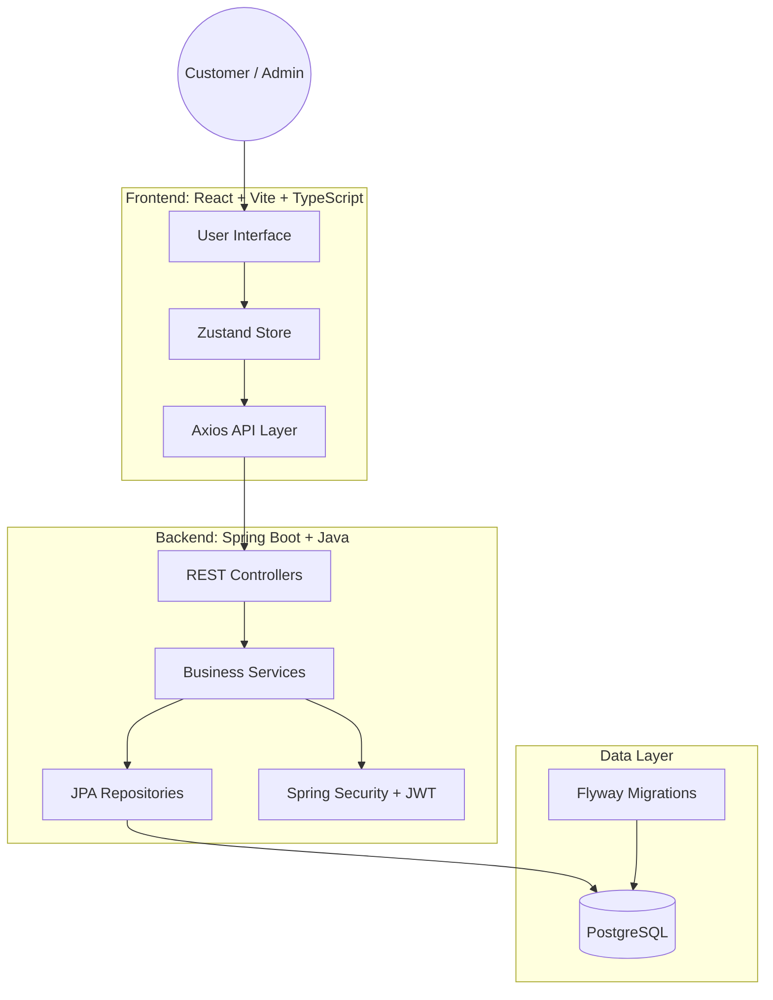
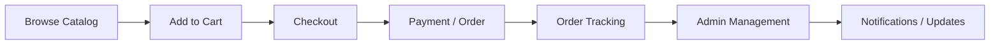

# MRS. DEORE'S Platform

<p align="center">
  
  
  
  
  
  
  
</p>

<p align="center">
  
</p>

A modern marketplace web application for buying products, managing orders, handling custom requests, and operating an admin panel — built with a Java Spring Boot backend and a React + TypeScript frontend.

## Overview

Mrs. Deore's Platform is a full-stack e-commerce solution designed for a retail marketplace experience. It combines a scalable backend, secure JWT-based authentication, PostgreSQL persistence, and a responsive Vite-powered frontend with Tailwind styling.

The project is structured as a monorepo with:
- Backend: Java + Spring Boot
- Frontend: React + TypeScript + Vite
- Database: PostgreSQL
- Infra: Docker Compose
- Styling: Tailwind CSS + modern UI patterns

---

## Architecture



---

## Key Features

- Product catalog and product detail pages
- Search, filtering, and collection browsing
- Shopping cart and wishlist support
- User authentication and profile management
- Address management and checkout flow
- Order history and order tracking
- Custom order requests
- Admin dashboard for products, orders, categories, and users
- Notifications and activity tracking
- Secure API layer with JWT-based authorization
- Razorpay-ready payment integration
- Cloudinary/media upload support
- Dockerized PostgreSQL setup

---

## Tech Stack

### Frontend
- React 19
- TypeScript
- Vite
- Tailwind CSS
- Framer Motion
- Zustand
- React Router
- Axios
- Recharts

### Backend
- Java 17
- Spring Boot 3.4.2
- Spring Security
- Spring Data JPA
- PostgreSQL
- Flyway
- JWT (jjwt)
- Lombok
- Razorpay Java SDK
- Spring Mail

### Infrastructure
- Docker Compose
- PostgreSQL 16
- Nginx-ready frontend serving pattern
- Local development and containerized database support

---

## Project Structure

```text
mrs-deores/
├── backend/
│   ├── src/
│   │   ├── main/
│   │   │   ├── java/com/mrsdeores/
│   │   │   │   ├── config
│   │   │   │   ├── controllers
│   │   │   │   ├── models
│   │   │   │   ├── payload
│   │   │   │   ├── repository
│   │   │   │   ├── security
│   │   │   │   └── services
│   │   │   └── resources
│   │   └── test
│   ├── pom.xml
│   ├── mvnw
│   ├── Dockerfile
│   └── .mvn/
├── frontend/
│   ├── src/
│   ├── public/
│   ├── package.json
│   ├── vite.config.ts
│   ├── tailwind.config.js
│   ├── server.js
│   └── index.html
├── docs/
├── scripts/
├── docker-compose.yml
├── ARCHITECTURE.md
├── PROJECT_RULES.md
├── CHANGELOG.md
├── GSD-STYLE.md
├── VERSION
├── .gitignore
├── .dockerignore
└── README.md
```

---

## Quick Start

### Prerequisites
- Java 17+
- Maven
- Node.js 18+
- npm
- Docker + Docker Compose

### 1) Start the database
```bash
docker compose up -d
```

This starts PostgreSQL on port `5432` using the configuration in `docker-compose.yml`.

### 2) Run the backend
```bash
cd backend
./mvnw clean spring-boot:run
```

The backend typically runs on:
- `http://localhost:8080`

### 3) Run the frontend
```bash
cd frontend
npm install
npm run dev
```

The frontend runs on:
- `http://localhost:5173`

---

## Environment Configuration

Create the required environment files for local development as needed.

### Backend
Typical backend config includes:
- database credentials
- JWT secret
- mail configuration
- Razorpay credentials
- Cloudinary settings

### Frontend
The frontend app expects appropriate API base URL and public config values, usually set through environment variables or `src/config.ts`.

---

## Admin & Marketplace Flow

The application supports a complete marketplace lifecycle:



This includes:
- customer browsing and purchasing
- order management
- admin-side product and category control
- custom order handling
- user engagement and notification flows

---

## Why This Project Stands Out

- Full-stack marketplace implementation from frontend to backend
- Clear layered architecture with Spring Boot conventions
- Strong product and admin workflows
- Modern UI using React and Tailwind
- Docker-friendly development setup
- Scalable monolith pattern suitable for future growth

---

## Contributing

Contributions are welcome. If you'd like to improve the project:

1. Fork the repository
2. Create a feature branch
3. Commit your work
4. Push your branch
5. Open a pull request

---

## License

This project does not currently declare a license in the repository metadata. If you plan to distribute or publish it publicly, add a license such as MIT or Apache 2.0.

---

## Project Summary

MRS. DEORE'S Platform is a practical, production-inspired marketplace application that blends modern frontend engineering with enterprise-grade backend architecture. It is an excellent example of a full-stack e-commerce solution built with TypeScript, Java, Spring Boot, React, Tailwind, PostgreSQL, and Docker.

<p align="center">
  <b>Built for commerce, designed for growth.</b>
</p>
